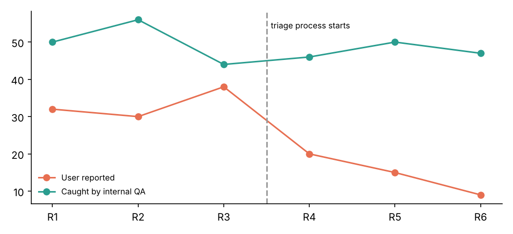
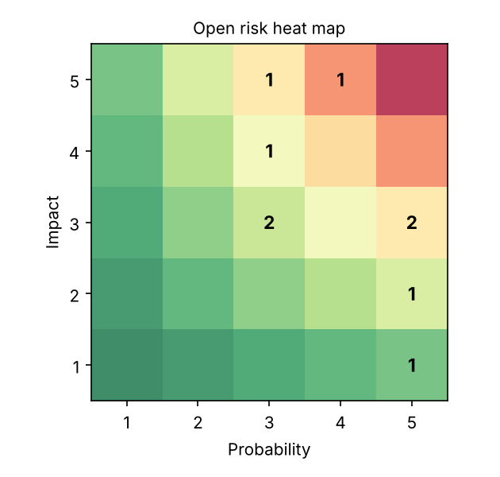

# Release Risk & Defect Tracker


A lightweight **release governance** tool: a SQL-backed risk register, defect-trend analysis across releases, and an automated **Go / Conditional Go / No-Go readiness gate** for release reviews.

## Why I built it

At AMD (client work) I supported program governance — risk and issue tracking, sprint progress reporting and milestone reviews across multiple releases using JIRA and Excel. The recurring pain was that every release review re-derived the same numbers by hand. This project models that workflow end-to-end so the review can focus on decisions, not spreadsheets.

## What it does

1. **Risk register (SQL)** — risks scored by *probability × impact* (1–5 each) and rated High (≥15) / Medium (≥8) / Low, with owner and status.
2. **Defect trends** — per-release counts split by source (internal QA vs. user-reported) and severity, plus average days-to-close.
3. **Component hotspots** — which components generate the most user-reported defects, so testing effort goes where it matters.
4. **Readiness gate** — explicit, configurable rules (no open high-exposure risks, no open S1s, ≤3 open S2s, every risk owned) produce a decision and a PASS/FAIL table.
5. **Report** — `reports/release_review.md` with a risk heat map and defect-trend chart.

## Quick start

**Easiest:** install the requirements, then run `python main.py`. It runs the whole project and prints where the results are.

Step by step:

```bash
python -m venv .venv && source .venv/bin/activate
pip install -r requirements.txt

PYTHONPATH=src python -m release_risk.cli build    # creates data/release.db (SQLite) with sample data
PYTHONPATH=src python -m release_risk.cli report   # writes reports/release_review.md
pytest
```

You can also open `data/release.db` in any SQLite client (DB Browser for SQLite, VS Code SQLite extension) and run the queries in `sql/queries.sql` directly.

## Sample output

With the bundled synthetic data, a data-driven triage process starts after Release 3 (extra test coverage on hotspot components):

- User-reported defects: **33 avg (R1–R3) → 9 (R6), −73%**
- Current release gate: **CONDITIONAL GO** — two open risks with score ≥ 15 need mitigation before ship




> All data is synthetic; no company data is included.

## Project structure

```
release-risk-tracker/
├── sql/
│   ├── schema.sql              # releases, risks, defects tables
│   └── queries.sql             # named analytical queries
├── src/release_risk/
│   ├── db.py                   # SQLite connection, schema, named-query runner
│   ├── sample_data.py          # synthetic data generator
│   ├── readiness.py            # Go/No-Go gate + defect trend
│   └── cli.py                  # build / report commands
├── reports/                    # generated review + charts
├── tests/test_release_risk.py
└── .github/workflows/tests.yml
```

## Tech

Python · SQL (SQLite) · pandas · matplotlib · pytest · GitHub Actions
